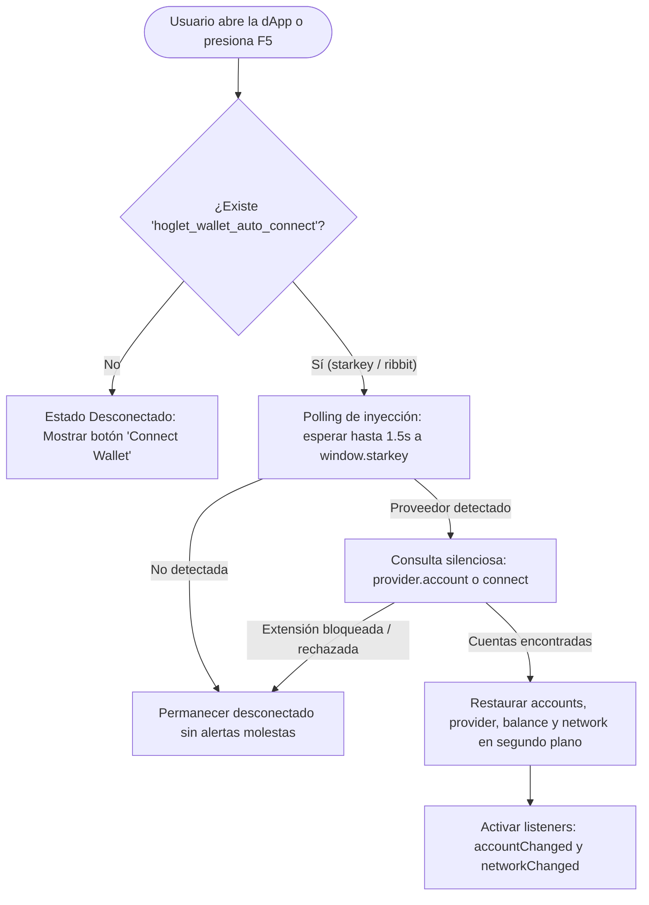

# 🔌 Receta Oficial: Auto-Reconexión Persistente de Wallets (Starkey & Ribbit) para dApps de Hoglet

Esta guía documenta la arquitectura e implementación estándar de **Eager Auto-Reconnection (Reconexión Silenciosa Persistente)** y **Escucha de Eventos de Billetera** para todas las aplicaciones descentralizadas del ecosistema Hoglet (`launch.hoglet.xyz`, `swap.hoglet.xyz`, `daos.hoglet.xyz`, `game.hoglet.xyz`, etc.).

---

## 📌 1. El Problema de UX y el Estándar de la Industria

### ❌ El Problema Actual
En muchas dApps, el estado de la billetera se reinicia a vacío (`accounts = []`) cada vez que el usuario presiona **F5** o recarga la página. Esto obliga al usuario a hacer clic repetidamente en *"Conectar Wallet"* y seleccionar su proveedor, generando una fricción inaceptable.

### ✅ El Estándar Web3 (Eager Connection)
En dApps líderes (Uniswap, Raydium, OpenSea, Phantom, MetaMask):
1. **Persistencia de Intención**: Si el usuario conectó su wallet con éxito, la dApp recuerda esa decisión en `localStorage`.
2. **Reconexión Silenciosa en <1s**: Al recargar la página, la dApp consulta silenciosamente a la extensión si la sesión sigue activa. Dado que el usuario ya autorizó el sitio previamente, la wallet responde de inmediato **sin abrir ninguna ventana emergente ni popup**.
3. **Desconexión Únicamente Explícita**: La sesión solo se olvida si el usuario hace clic deliberadamente en **"Disconnect"**.
4. **Eventos Reactivos**: Si el usuario cambia de cuenta dentro de la extensión (por ejemplo, en Starkey), la dApp se actualiza al instante sin desloguearlo.

---

## 🧱 2. Arquitectura de Reconexión Silenciosa



---

## 🚀 3. Desafío Técnico Clave: Latencia de Inyección

Las extensiones de navegador Web3 inyectan su objeto en `window` (`window.starkey.supra`) en tiempo de ejecución. Frecuentemente, el framework (Next.js / React) monta los componentes unos **100ms a 300ms antes** de que la extensión termine de inyectarse.

> **Regla de Oro:** Nunca asumas que `window.starkey.supra` está disponible en el milisegundo 0 del montaje. Se debe implementar un ciclo de sondeo breve (polling de hasta 1.5 segundos con intervalos de 100ms) antes de desistir.

---

## 💻 4. Implementación Paso a Paso

### Paso 1: Constante de Almacenamiento

Define la clave persistente unificada para todo el ecosistema Hoglet:

```typescript
export const AUTO_CONNECT_STORAGE_KEY = 'hoglet_wallet_auto_connect';
```

---

### Paso 2: Hook Completo `useWalletConnection.ts`

Reemplaza o actualiza tu hook de conexión de wallet (`src/app/hooks/features/wallet/useWalletConnection.ts` o equivalente):

```typescript
// useWalletConnection.ts
import { useState, useEffect, useCallback } from 'react';
import { showWarningToast } from '@/src/app/utils/alertService';
import { WalletType } from '@/src/app/utils/types';
import { WALLET_CONFIGS } from '@/src/app/utils/supra/wallet-configs';
import { getStoredWalletType, setStoredWalletType, clearStoredWalletType } from '@/src/app/utils/supra/storage';
import type { DappMetadata, WalletInfo, WalletBalanceRequest } from 'ribbit-wallet-connect';

export const AUTO_CONNECT_STORAGE_KEY = 'hoglet_wallet_auto_connect';

export const useWalletConnection = () => {
  const [selectedWallet, setSelectedWallet] = useState<WalletType>(getStoredWalletType);
  const [accounts, setAccounts] = useState<string[]>([]);
  const [balance, setBalance] = useState<string>('');
  const [networkData, setNetworkData] = useState<any>({});
  const [isExtensionInstalled, setIsExtensionInstalled] = useState<boolean>(false);
  const [loading, setLoading] = useState<boolean>(false);
  const [provider, setProvider] = useState<any>(null);

  const getProvider = useCallback(async (type: WalletType = selectedWallet) => {
    return await WALLET_CONFIGS[type].provider();
  }, [selectedWallet]);

  const updateBalance = useCallback(async (currentProvider: any, wallet: WalletType, account: string) => {
    if (!currentProvider || !account) {
      setBalance('');
      return;
    }
    try {
      if (wallet === 'starkey') {
        const bal = await currentProvider.balance();
        if (bal) setBalance(`${bal.formattedBalance} ${bal.displayUnit}`);
      } else if (wallet === 'ribbit') {
        const balanceReq: WalletBalanceRequest = {
          chainId: 8, // 8 = Mainnet, 6 = Testnet
          resourceType: '0x1::supra_coin::SupraCoin',
          decimals: 7,
        };
        const res = await currentProvider.getWalletBalance(balanceReq);
        setBalance(`${res.balance || 0} SUPRA`);
      }
    } catch (error) {
      console.error('Error updating balance:', error);
      setBalance('');
    }
  }, []);

  const getNetworkData = useCallback(async (currentProvider: any, wallet: WalletType) => {
    if (!currentProvider) return {};
    try {
      if (wallet === 'starkey') {
        const data = await currentProvider.getChainId();
        setNetworkData(data || {});
        return data;
      } else {
        const mockData = { chainId: '8' };
        setNetworkData(mockData);
        return mockData;
      }
    } catch {
      return {};
    }
  }, []);

  // 1. RECONEXIÓN SILENCIOSA (EAGER CONNECTION) AL MONTAR
  useEffect(() => {
    let isCancelled = false;

    const attemptAutoConnect = async () => {
      if (typeof window === 'undefined') return;

      const savedWallet = localStorage.getItem(AUTO_CONNECT_STORAGE_KEY) as WalletType | null;
      if (!savedWallet || !['starkey', 'ribbit'].includes(savedWallet)) {
        return;
      }

      // Sondeo para esperar la inyección de la extensión (hasta 1.5s)
      const waitForProvider = async (wallet: WalletType, maxRetries = 15): Promise<any> => {
        for (let i = 0; i < maxRetries; i++) {
          if (isCancelled) return null;
          const prov = await WALLET_CONFIGS[wallet].provider();
          if (prov) return prov;
          await new Promise((resolve) => setTimeout(resolve, 100));
        }
        return null;
      };

      try {
        const currentProvider = await waitForProvider(savedWallet);
        if (!currentProvider || isCancelled) return;

        let connectedAccount = '';

        if (savedWallet === 'starkey') {
          // Consulta sin abrir popups
          try {
            const accs: string[] = (await currentProvider.account()) || [];
            if (accs.length > 0) {
              connectedAccount = accs[0];
            } else {
              // Si no devuelve cuenta directa, conectar silenciosamente (no abre popup si ya fue autorizado)
              await currentProvider.connect();
              const freshAccs: string[] = (await currentProvider.account()) || [];
              if (freshAccs.length > 0) connectedAccount = freshAccs[0];
            }
          } catch {
            // Extensión bloqueada por contraseña; fallar en silencio sin alarmar al usuario
          }
        } else if (savedWallet === 'ribbit') {
          try {
            const info = currentProvider.getWalletInfo?.();
            if (info?.connected && info?.walletAddress) {
              connectedAccount = info.walletAddress;
            }
          } catch {}
        }

        if (connectedAccount && !isCancelled) {
          setAccounts([connectedAccount]);
          setProvider(currentProvider);
          setSelectedWallet(savedWallet);
          setStoredWalletType(savedWallet);
          setIsExtensionInstalled(true);
          localStorage.setItem('starkey.accounts.0', connectedAccount);

          await updateBalance(currentProvider, savedWallet, connectedAccount);
          await getNetworkData(currentProvider, savedWallet);
        }
      } catch (err) {
        console.debug('[Wallet Auto-Connect] Fallback silencioso:', err);
      }
    };

    attemptAutoConnect();

    return () => {
      isCancelled = true;
    };
  }, [updateBalance, getNetworkData]);

  // 2. FUNCIÓN DE CONEXIÓN EXPLÍCITA
  const connect = async (walletType?: WalletType) => {
    const targetWallet = walletType || selectedWallet;
    const currentProvider = await WALLET_CONFIGS[targetWallet].provider();

    if (!currentProvider) {
      showWarningToast('Extension not installed', `Please install the ${targetWallet} extension`);
      return null;
    }

    setLoading(true);
    try {
      let connectedAccount = '';

      if (targetWallet === 'starkey') {
        await currentProvider.connect();
        const responseAcc = await currentProvider.account();
        if (responseAcc.length > 0) {
          connectedAccount = responseAcc[0];
          localStorage.setItem('starkey.accounts.0', connectedAccount);
        }
      } else if (targetWallet === 'ribbit') {
        const dappMetadata: DappMetadata = {
          name: 'Hoglet dApp',
          description: 'Hoglet Ecosystem Integration',
          logo: window.location.origin + '/favicon.ico',
          url: window.location.origin,
        };
        const response: WalletInfo = await currentProvider.connectToWallet(dappMetadata);
        if (response.connected && response.walletAddress) {
          connectedAccount = response.walletAddress;
        }
      }

      if (connectedAccount) {
        setAccounts([connectedAccount]);
        setProvider(currentProvider);
        setSelectedWallet(targetWallet);
        setStoredWalletType(targetWallet);

        // Guardar preferencia para auto-reconexión futura
        if (typeof window !== 'undefined') {
          localStorage.setItem(AUTO_CONNECT_STORAGE_KEY, targetWallet);
        }

        await updateBalance(currentProvider, targetWallet, connectedAccount);
        await getNetworkData(currentProvider, targetWallet);

        return { account: connectedAccount, provider: currentProvider, walletType: targetWallet };
      } else {
        throw new Error('No account found');
      }
    } finally {
      setLoading(false);
    }
  };

  // 3. DESCONEXIÓN EXPLÍCITA (Borra sesión y auto-reconexión)
  const disconnect = useCallback(async () => {
    const currentProvider = await getProvider();
    try {
      if (currentProvider) await currentProvider.disconnect();
    } catch (e) {
      console.error('Error disconnecting', e);
    }

    setAccounts([]);
    setBalance('');
    setProvider(null);
    clearStoredWalletType();

    if (typeof window !== 'undefined') {
      localStorage.removeItem(AUTO_CONNECT_STORAGE_KEY);
      localStorage.removeItem('starkey.accounts.0');
    }
  }, [getProvider]);

  // 4. ESCUCHA DE EVENTOS REACTIVOS (Cambio de cuenta y red)
  useEffect(() => {
    if (!provider || selectedWallet !== 'starkey') return;

    const handleAccountsChanged = (newAccounts: string[]) => {
      if (newAccounts && newAccounts.length > 0) {
        const nextAccount = newAccounts[0];
        setAccounts([nextAccount]);
        localStorage.setItem('starkey.accounts.0', nextAccount);
        updateBalance(provider, 'starkey', nextAccount);
      } else {
        // El usuario se desconectó desde la propia extensión
        disconnect();
      }
    };

    const handleNetworkChanged = (data: any) => {
      setNetworkData(data || {});
    };

    try {
      if (typeof provider.on === 'function') {
        provider.on('accountChanged', handleAccountsChanged);
        provider.on('networkChanged', handleNetworkChanged);
      }
    } catch (e) {
      console.debug('Failed to attach Starkey event listeners:', e);
    }

    return () => {
      try {
        if (typeof provider.removeListener === 'function') {
          provider.removeListener('accountChanged', handleAccountsChanged);
          provider.removeListener('networkChanged', handleNetworkChanged);
        } else if (typeof provider.off === 'function') {
          provider.off('accountChanged', handleAccountsChanged);
          provider.off('networkChanged', handleNetworkChanged);
        }
      } catch {}
    };
  }, [provider, selectedWallet, updateBalance, disconnect]);

  return {
    selectedWallet,
    accounts,
    balance,
    networkData,
    isExtensionInstalled,
    loading,
    provider,
    connect,
    disconnect,
    updateBalance: () => accounts[0] && updateBalance(provider, selectedWallet, accounts[0]),
  };
};
```

---

## 🧪 5. Guía de Pruebas (QA Testing Checklist)

| Test Case | Pasos | Resultado Esperado |
| :--- | :--- | :--- |
| **1. Conexión Inicial** | Hacer clic en "Connect Wallet", elegir Starkey y autorizar. | La cuenta y el saldo se muestran de inmediato. En `localStorage` se guarda `hoglet_wallet_auto_connect = "starkey"`. |
| **2. Recarga con F5 (Prueba de Fuego)** | Con la wallet conectada, presionar **F5** o `Ctrl + R`. | La dApp se recarga y en **< 500ms** muestra tu cuenta y saldo conectados. **NO debe aparecer ningún popup ni ventana emergente**. |
| **3. Cambio de Cuenta en Starkey** | Abrir la extensión Starkey y cambiar a otra cuenta. | La dApp detecta el evento `accountChanged` al instante y actualiza la dirección en pantalla sin pedir login. |
| **4. Desconexión Voluntaria** | Hacer clic en el botón "Disconnect" de la dApp. | Se borra la sesión y se limpia `hoglet_wallet_auto_connect`. Al presionar F5, la dApp permanece desconectada. |
| **5. Extensión Bloqueada** | Bloquear Starkey con contraseña y recargar la página. | La dApp permanece desconectada pacíficamente, **sin mostrar errores en toast ni romper la interfaz**. |

---

## 🌐 6. Integración con Supra Name Service (SNS / SupraNS) con Caché

Mostrar el nombre del dominio (`alice.supra` o `harrystyles.supra`) en lugar de la dirección hexadecimal en bruto (`0x0eb3...b656`) eleva drásticamente la calidad visual y la confianza en la dApp.

### ⚙️ Arquitectura de Resolución Inversa On-Chain

- **Mainnet Router:** `0x41aa7e05da1d6f014a59247d06c1832fc4437964b8d21e1f8df7a464f06ea920::router::get_primary_name`
- **Testnet Router:** `0x1536b1ec627c2f0d922572b4f2c0c410659fb2ee1789c5dc235a9cc7a536f9cc::router::get_primary_name`
- **RPC View Call Endpoint:** `POST https://rpc-mainnet.supra.com/rpc/v1/view`
- **Estrategia de Caché en 2 Capas:**
  1. **Memoria (`Map`)**: Búsqueda síncrona en 0ms entre re-renders de componentes.
  2. **`localStorage` (TTL 24 horas)**: Persistencia entre recargas de página para no saturar los RPCs de Supra con consultas repetitivas.

---

### Módulo de Utilidad: `src/app/utils/snsUtils.ts`

```typescript
// src/app/utils/snsUtils.ts
const SNS_CONTRACT_MAINNET = "0x41aa7e05da1d6f014a59247d06c1832fc4437964b8d21e1f8df7a464f06ea920";
const SNS_CONTRACT_TESTNET = "0x1536b1ec627c2f0d922572b4f2c0c410659fb2ee1789c5dc235a9cc7a536f9cc";
const RPC_MAINNET = "https://rpc-mainnet.supra.com/rpc/v1/view";
const RPC_TESTNET = "https://rpc-testnet.supra.com/rpc/v1/view";

const SNS_CACHE_KEY = "hoglet_sns_cache_v1";
const CACHE_TTL_MS = 24 * 60 * 60 * 1000; // 24 horas

interface CacheRecord {
  name: string | null;
  timestamp: number;
}

const memoryCache = new Map<string, CacheRecord>();

if (typeof window !== "undefined") {
  try {
    const raw = localStorage.getItem(SNS_CACHE_KEY);
    if (raw) {
      const parsed = JSON.parse(raw);
      const now = Date.now();
      for (const [key, record] of Object.entries(parsed)) {
        if (record && typeof record === "object" && now - (record as any).timestamp < CACHE_TTL_MS) {
          memoryCache.set(key, record as CacheRecord);
        }
      }
    }
  } catch {}
}

function persistToLocalStorage() {
  if (typeof window === "undefined") return;
  try {
    const obj: Record<string, CacheRecord> = {};
    let count = 0;
    for (const [k, v] of memoryCache.entries()) {
      obj[k] = v;
      if (++count >= 150) break;
    }
    localStorage.setItem(SNS_CACHE_KEY, JSON.stringify(obj));
  } catch {}
}

export async function resolveSupraName(
  address: string | null | undefined,
  network?: string | null
): Promise<string | null> {
  if (!address || !address.startsWith("0x")) return null;

  const clean = address.trim().toLowerCase();
  const isTestnet = network === "supra-testnet";
  const cacheKey = `${isTestnet ? "testnet" : "mainnet"}_${clean}`;

  // 1. Caché en memoria
  const cached = memoryCache.get(cacheKey);
  if (cached && Date.now() - cached.timestamp < CACHE_TTL_MS) {
    return cached.name;
  }

  // 2. Consulta RPC View Function
  const contract = isTestnet ? SNS_CONTRACT_TESTNET : SNS_CONTRACT_MAINNET;
  const rpcUrl = isTestnet ? RPC_TESTNET : RPC_MAINNET;

  try {
    const controller = new AbortController();
    const timeout = setTimeout(() => controller.abort(), 6000);

    const res = await fetch(rpcUrl, {
      method: "POST",
      headers: { "Content-Type": "application/json" },
      body: JSON.stringify({
        function: `${contract}::router::get_primary_name`,
        type_arguments: [],
        arguments: [clean],
      }),
      signal: controller.signal,
    });
    clearTimeout(timeout);

    if (!res.ok) return null;
    const data = await res.json();
    let resolvedName: string | null = null;

    if (data?.result && Array.isArray(data.result) && data.result.length >= 2) {
      const subdomain = data.result[0]?.vec?.[0];
      const domain = data.result[1]?.vec?.[0];
      if (domain && typeof domain === "string") {
        resolvedName = subdomain ? `${subdomain}.${domain}.supra` : `${domain}.supra`;
      }
    }

    // Guardar en caché (incluso null para no re-consultar direcciones sin SNS)
    memoryCache.set(cacheKey, { name: resolvedName, timestamp: Date.now() });
    persistToLocalStorage();

    return resolvedName;
  } catch {
    return null;
  }
}
```

---

### Hook de React: `src/app/hooks/features/wallet/useSupraName.ts`

```typescript
// src/app/hooks/features/wallet/useSupraName.ts
'use client';
import { useState, useEffect } from 'react';
import { resolveSupraName } from '@/src/app/utils/snsUtils';

export function useSupraName(address: string | null | undefined, network?: string | null) {
  const [snsName, setSnsName] = useState<string | null>(null);
  const [isLoading, setIsLoading] = useState<boolean>(false);

  useEffect(() => {
    let isCancelled = false;
    if (!address || !address.startsWith('0x')) {
      setSnsName(null);
      return;
    }

    setIsLoading(true);
    resolveSupraName(address, network)
      .then((name) => {
        if (!isCancelled) {
          setSnsName(name);
          setIsLoading(false);
        }
      })
      .catch(() => {
        if (!isCancelled) setIsLoading(false);
      });

    return () => { isCancelled = true; };
  }, [address, network]);

  const shortAddress = address ? `${address.slice(0, 6)}...${address.slice(-4)}` : '';
  const displayName = snsName || shortAddress;

  return { snsName, shortAddress, displayName, isLoading };
}
```

---

### Integración en el Botón de Wallet (`WalletConnect.tsx`)

```tsx
const { snsName, displayName, shortAddress } = useSupraName(walletAddress, network);

// En el botón principal:
<button className="flex items-center gap-2 ...">
  {snsName ? (
    <>
      <span className="w-2 h-2 rounded-full bg-cyan-400 animate-pulse" />
      <span className="text-cyan-300 font-mono font-semibold">{snsName}</span>
    </>
  ) : (
    <span>{displayName}</span>
  )}
</button>
```

---

## 📋 Resumen para Aplicar en Otros Repositorios

1. **Auto-Reconexión:** Copiar `useWalletConnection.ts` con el sondeo de inyección (`waitForProvider`).
2. **SupraNS (SNS):** Copiar `src/app/utils/snsUtils.ts` y el hook `useSupraName.ts`.
3. **UI Elegante:** En `WalletConnect.tsx`, renderizar `snsName` con badge holográfico cian, o la dirección corta como fallback seguro.

