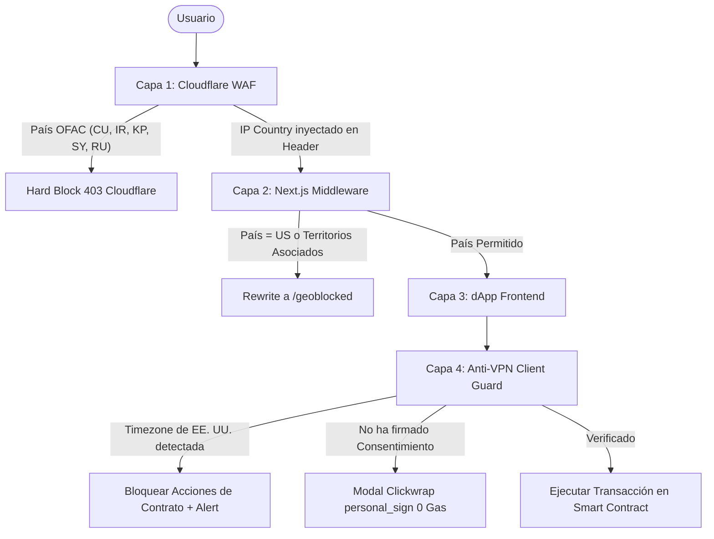

# 🛡️ Receta Oficial: Geobloqueo y Cumplimiento Legal para dApps de Hoglet

Esta guía documenta la arquitectura e implementación estándar de **Geobloqueo (Edge + Next.js) y Anti-VPN (Client-Side Clickwrap)** para todas las aplicaciones descentralizadas interactivas del ecosistema Hoglet (`daos.hoglet.xyz`, `launch.hoglet.xyz`, `amm.hoglet.xyz`, etc.).

---

## 📌 1. Principio de Separación: ¿Por qué NO bloquear `hoglet.xyz`?

| Dominio | Tipo | Geobloqueo | Razón Legal & Técnica |
| :--- | :--- | :--- | :--- |
| **`hoglet.xyz`** | Landing / Marketing / Docs | ❌ **Abierto Globalmente** | • Indexación de Googlebot / SEO (servidores en EE. UU.)<br>• Tarjetas de Twitter/X y Discord bots<br>• Contenido meramente educativo amparado bajo libertad de información (no ejecuta contratos). |
| **`daos.hoglet.xyz`**, **`launch.hoglet.xyz`**, **`amm.hoglet.xyz`** | dApps Interactivas | ✅ **Geobloqueadas** | • Interacción con Smart Contracts (Swaps, Creación de DAOs, Tokens, Staking).<br>• Requerimiento de exclusión regulatoria de EE. UU. (SEC/CFTC) y OFAC. |

---

## 🧱 2. Arquitectura de Defensa en 4 Capas



---

## 🚀 3. Implementación Paso a Paso en un Nuevo Repositorio

### Paso 1: Configurar el Middleware (`middleware.ts`)

Crea o actualiza el archivo `src/middleware.ts` (o en la raíz del proyecto):

```typescript
// middleware.ts
import { NextRequest, NextResponse } from 'next/server';

// Estados Unidos, territorios asociados y países sancionados por OFAC
export const RESTRICTED_REGIONS = [
  'US', // United States
  'PR', // Puerto Rico
  'VI', // U.S. Virgin Islands
  'GU', // Guam
  'AS', // American Samoa
  'MP', // Northern Mariana Islands
  'CU', // Cuba
  'IR', // Iran
  'KP', // North Korea
  'SY', // Syria
  'RU', // Russia
];

export async function middleware(request: NextRequest) {
  const { pathname } = request.nextUrl;

  // 1. Evitar bucles en la vista de geobloqueo
  if (pathname === '/geoblocked' || pathname.endsWith('/geoblocked')) {
    return NextResponse.next();
  }

  // 2. Extraer país de Cloudflare o Vercel (con bypass para testing local)
  const isDev = process.env.NODE_ENV !== 'production';
  const testCountry = isDev
    ? (request.nextUrl.searchParams.get('test_country') || request.headers.get('x-test-country') || '')
    : '';

  const country = (
    testCountry ||
    request.headers.get('cf-ipcountry') ||
    request.headers.get('x-vercel-ip-country') ||
    ''
  ).trim().toUpperCase();

  // 3. Evaluar jurisdicción restringida
  if (RESTRICTED_REGIONS.includes(country)) {
    // Si la petición es hacia /api, retornar JSON 403 estructurado
    if (pathname.startsWith('/api/')) {
      return NextResponse.json(
        {
          error: 'Access to this service is restricted in your jurisdiction.',
          code: 'GEOBLOCKED',
          country,
        },
        { status: 403 }
      );
    }

    // Para navegación web, reescribir transparentemente a /geoblocked
    return NextResponse.rewrite(new URL('/geoblocked', request.url));
  }

  return NextResponse.next();
}

export const config = {
  // Excluye assets estáticos, imágenes, fuentes y favicon
  matcher: ['/((?!_next/static|_next/image|favicon.ico|.*\\.(?:svg|png|jpg|jpeg|gif|webp|ico)$).*)'],
};
```

> **Nota para repositorios con `next-intl`:**  
> Si tu repo usa `next-intl`, en vez de retornar directamente `NextResponse.next()`, invoca `intlMiddleware(request)` para usuarios no restringidos y aplica los headers de seguridad (CSP, HSTS).

---

### Paso 2: Crear la Página `/geoblocked`

Crea el archivo `src/app/geoblocked/page.tsx`:

```tsx
// src/app/geoblocked/page.tsx
import React from 'react';
import Image from 'next/image';
import Link from 'next/link';
import { ShieldAlert, Globe, ExternalLink, FileText, AlertTriangle } from 'lucide-react';
import type { Metadata } from 'next';

export const metadata: Metadata = {
  title: 'Restricted Access | Hoglet Protocol',
  description: 'Access to this decentralized application interface is restricted in your region.',
  robots: { index: false, follow: false },
};

export default function GeoblockedPage() {
  return (
    <main className="min-h-screen w-full bg-black text-white flex flex-col justify-between items-center relative overflow-hidden px-4 py-8 sm:py-12">
      <div className="absolute top-1/4 left-1/2 -translate-x-1/2 -translate-y-1/2 w-[350px] sm:w-[600px] h-[350px] sm:h-[600px] bg-gradient-to-tr from-red-950/30 via-red-900/10 to-transparent rounded-full blur-3xl pointer-events-none" />

      {/* Brand Header */}
      <header className="w-full max-w-4xl flex items-center justify-between z-10 py-2">
        <div className="flex items-center gap-3">
          <div className="w-10 h-10 relative rounded-xl overflow-hidden bg-black/60 border border-red-500/30 p-1.5 shadow-[0_0_15px_rgba(220,38,38,0.2)]">
            <Image src="/main/icon.png" alt="Hoglet Logo" width={40} height={40} className="object-contain" priority />
          </div>
          <div>
            <span className="font-extrabold tracking-wider text-sm sm:text-base text-gray-100 uppercase">
              Hoglet <span className="text-red-500">Protocol</span>
            </span>
            <p className="text-[10px] text-gray-500 tracking-wider">COMPLIANCE & RISK ENGINE</p>
          </div>
        </div>

        <div className="flex items-center gap-2 px-3 py-1 rounded-full bg-red-500/10 border border-red-500/30 text-red-400 text-xs font-mono font-medium">
          <span className="w-2 h-2 rounded-full bg-red-500 animate-ping inline-block" />
          <span>ACCESS RESTRICTED</span>
        </div>
      </header>

      {/* Legal Shield Card */}
      <div className="w-full max-w-2xl my-auto z-10 py-8">
        <div className="relative rounded-3xl bg-neutral-950/80 border border-neutral-800/80 p-6 sm:p-10 shadow-2xl backdrop-blur-xl overflow-hidden">
          <div className="absolute top-0 left-0 right-0 h-[2px] bg-gradient-to-r from-transparent via-red-500 to-transparent opacity-80" />

          <div className="flex flex-col items-center text-center">
            <div className="w-20 h-20 rounded-2xl bg-red-500/10 border border-red-500/30 flex items-center justify-center text-red-500 mb-6 shadow-[0_0_30px_rgba(239,68,68,0.25)]">
              <ShieldAlert className="w-10 h-10 animate-pulse" />
            </div>

            <h1 className="text-2xl sm:text-3xl font-extrabold tracking-tight text-white mb-3">
              Restricted Jurisdiction
            </h1>
            
            <p className="text-sm sm:text-base text-gray-300 leading-relaxed mb-6 max-w-xl">
              Access to this decentralized interface is not available for persons or entities located in, 
              incorporated in, or residents of the <span className="text-white font-semibold">United States</span> and other 
              restricted territories, in accordance with applicable regulatory frameworks and our Terms of Service.
            </p>

            <div className="w-full text-left bg-neutral-900/60 rounded-2xl border border-neutral-800 p-4 sm:p-5 mb-8">
              <div className="flex items-center gap-2 text-xs font-semibold text-gray-300 uppercase tracking-wider mb-3">
                <Globe className="w-4 h-4 text-red-400" />
                <span>Geographical Restrictions Include:</span>
              </div>
              <ul className="text-xs sm:text-sm text-gray-400 space-y-2">
                <li className="flex items-start gap-2">
                  <span className="text-red-400 font-bold">•</span>
                  <span>United States of America and its territories (Puerto Rico, U.S. Virgin Islands, Guam, American Samoa, Northern Mariana Islands).</span>
                </li>
                <li className="flex items-start gap-2">
                  <span className="text-red-400 font-bold">•</span>
                  <span>Jurisdictions subject to OFAC and comprehensive international sanctions (Cuba, Iran, North Korea, Syria, Russia / Crimea).</span>
                </li>
                <li className="flex items-start gap-2">
                  <span className="text-red-400 font-bold">•</span>
                  <span>Use of Virtual Private Networks (VPN) or proxy servers to circumvent regional access controls is strictly prohibited.</span>
                </li>
              </ul>
            </div>

            <div className="flex items-center gap-2 text-[11px] text-gray-500 mb-8 bg-neutral-900/40 px-4 py-2 rounded-xl border border-neutral-800/40">
              <AlertTriangle className="w-4 h-4 text-amber-500 shrink-0" />
              <span>Underlying smart contracts on the blockchain remain public and autonomous. This interface restriction applies exclusively to this hosted front-end.</span>
            </div>

            {/* Links informativos (ESTRICTAMENTE SIN BOTÓN DE WALLET) */}
            <div className="w-full flex flex-col sm:flex-row items-center justify-center gap-3">
              <a
                href="https://hoglet.xyz"
                className="w-full sm:w-auto inline-flex items-center justify-center gap-2 px-6 py-3 rounded-xl bg-white text-black font-semibold text-sm hover:bg-gray-200 transition shadow-lg"
              >
                <span>Hoglet Portal</span>
                <ExternalLink className="w-4 h-4" />
              </a>

              <Link
                href="/terms"
                className="w-full sm:w-auto inline-flex items-center justify-center gap-2 px-6 py-3 rounded-xl bg-neutral-900 hover:bg-neutral-800 border border-neutral-700 text-gray-200 font-medium text-sm transition"
              >
                <FileText className="w-4 h-4 text-gray-400" />
                <span>Terms of Service</span>
              </Link>
            </div>
          </div>
        </div>
      </div>

      <footer className="w-full max-w-4xl text-center z-10 pt-4 border-t border-neutral-900 text-xs text-gray-600 flex flex-col sm:flex-row items-center justify-between gap-2">
        <p>© {new Date().getFullYear()} Hoglet Ecosystem. All rights reserved.</p>
        <p className="font-mono text-[11px]">Enforced by Cloudflare Edge Policy</p>
      </footer>
    </main>
  );
}
```

---

### Paso 3: Módulo de Detección Anti-VPN y Clickwrap (`src/lib/compliance.ts`)

Crea `src/lib/compliance.ts`:

```typescript
// src/lib/compliance.ts
export const TOS_COMPLIANCE_VERSION = 'v1.0';

/**
 * Zonas horarias IANA estrictas de EE. UU. (no usar prefijo genérico para no afectar a Latinoamérica).
 */
export const US_IANA_TIMEZONES = new Set([
  'America/New_York', 'America/Detroit', 'America/Kentucky/Louisville', 'America/Kentucky/Monticello',
  'America/Indiana/Indianapolis', 'America/Indiana/Vincennes', 'America/Indiana/Winamac',
  'America/Indiana/Marengo', 'America/Indiana/Petersburg', 'America/Indiana/Vevay',
  'America/Chicago', 'America/Indiana/Tell_City', 'America/Indiana/Knox', 'America/Menominee',
  'America/North_Dakota/Center', 'America/North_Dakota/New_Salem', 'America/North_Dakota/Beulah',
  'America/Denver', 'America/Boise', 'America/Phoenix', 'America/Los_Angeles',
  'America/Anchorage', 'America/Juneau', 'America/Sitka', 'America/Metlakatla',
  'America/Yakutat', 'America/Nome', 'America/Adak', 'Pacific/Honolulu',
  'America/Puerto_Rico', 'America/St_Thomas', 'Pacific/Guam', 'Pacific/Pago_Pago', 'Pacific/Saipan'
]);

export const LEGAL_CONSENT_MESSAGE = `[HOGLET PROTOCOL - JURISDICTION CERTIFICATION]
By signing this message, you certify and warrant that:
1. You are NOT a citizen, resident, or entity located or incorporated in the United States of America, its territories, or any OFAC-sanctioned jurisdiction.
2. You are NOT using a Virtual Private Network (VPN), proxy, Tor, or any tool to disguise your true IP address or physical location.
3. You will not access this interface or execute smart contract transactions on behalf of any restricted person or entity.
4. You have read, understood, and agreed to the Terms of Service and Privacy Policy.

Compliance Version: ${TOS_COMPLIANCE_VERSION}`;

export function getUserTimezone(): string {
  try {
    return Intl.DateTimeFormat().resolvedOptions().timeZone || '';
  } catch {
    return '';
  }
}

export function isUSTimezone(): boolean {
  const tz = getUserTimezone();
  return US_IANA_TIMEZONES.has(tz);
}

export function getConsentStorageKey(address: string): string {
  return `hoglet_legal_consent_${TOS_COMPLIANCE_VERSION}_${address.toLowerCase().trim()}`;
}

export function hasUserSignedConsent(address?: string | null): boolean {
  if (!address || typeof window === 'undefined') return false;
  try {
    const data = localStorage.getItem(getConsentStorageKey(address));
    if (!data) return false;
    const parsed = JSON.parse(data);
    return Boolean(parsed?.signature);
  } catch {
    return false;
  }
}

export function saveUserSignedConsent(address: string, signature: string): void {
  if (!address || typeof window === 'undefined') return;
  try {
    localStorage.setItem(
      getConsentStorageKey(address),
      JSON.stringify({
        address: address.toLowerCase().trim(),
        version: TOS_COMPLIANCE_VERSION,
        signature,
        timezone: getUserTimezone(),
        timestamp: new Date().toISOString(),
      })
    );
  } catch (err) {
    console.error('Failed to save legal consent in localStorage:', err);
  }
}
```

---

### Paso 4: Hook de React (`src/app/hooks/useLegalCompliance.ts`)

```typescript
// src/app/hooks/useLegalCompliance.ts
'use client';

import { useState, useEffect, useCallback } from 'react';
import { useSupraWallet } from '@/src/app/context/SupraWalletContext';
import {
  isUSTimezone,
  getUserTimezone,
  hasUserSignedConsent,
  saveUserSignedConsent,
  LEGAL_CONSENT_MESSAGE,
} from '@/src/lib/compliance';
import { toast } from 'sonner';

export function useLegalCompliance() {
  const { accounts, signMessage } = useSupraWallet();
  const currentAccount = accounts[0] || '';

  const [hasConsent, setHasConsent] = useState<boolean>(false);
  const [isUSDetected, setIsUSDetected] = useState<boolean>(false);
  const [userTimezone, setUserTimezone] = useState<string>('');
  const [isSigningConsent, setIsSigningConsent] = useState<boolean>(false);
  const [showConsentModal, setShowConsentModal] = useState<boolean>(false);

  useEffect(() => {
    setIsUSDetected(isUSTimezone());
    setUserTimezone(getUserTimezone());
  }, []);

  useEffect(() => {
    if (currentAccount) {
      setHasConsent(hasUserSignedConsent(currentAccount));
    } else {
      setHasConsent(false);
    }
  }, [currentAccount]);

  const requestSignConsent = useCallback(async (): Promise<boolean> => {
    if (!currentAccount) {
      toast.error('Connect wallet first.');
      return false;
    }
    if (isUSTimezone()) {
      toast.error('Access restricted: US timezone detected.');
      return false;
    }

    setIsSigningConsent(true);
    try {
      const nonce = Math.floor(Date.now() / 1000).toString();
      const res = await signMessage(LEGAL_CONSENT_MESSAGE, nonce);

      if (res?.signature) {
        saveUserSignedConsent(currentAccount, res.signature);
        setHasConsent(true);
        setShowConsentModal(false);
        toast.success('Jurisdiction certification verified.');
        return true;
      }
    } catch (err: any) {
      toast.error(err?.message || 'Signature rejected by user.');
    } finally {
      setIsSigningConsent(false);
    }
    return false;
  }, [currentAccount, signMessage]);

  return {
    isUSDetected,
    userTimezone,
    hasConsent,
    isSigningConsent,
    showConsentModal,
    setShowConsentModal,
    requestSignConsent,
  };
}
```

---

### Paso 5: Proteger la Ejecución de Smart Contracts

En el hook donde se envían transacciones (`useWalletTransactions.ts` o la función `sendRawTransaction` / `executeTransaction`):

```typescript
import { isUSTimezone, hasUserSignedConsent } from '@/src/lib/compliance';
import { toast } from 'sonner';

// Dentro de sendRawTransaction / executeTransaction:
if (isUSTimezone()) {
  toast.error('Transaction blocked: United States jurisdiction detected.');
  throw new Error('Access restricted for residents in the United States.');
}

if (!hasUserSignedConsent(account)) {
  toast.error('Jurisdiction certification required before executing transactions.');
  if (typeof window !== 'undefined') {
    window.dispatchEvent(new CustomEvent('open-legal-consent-modal'));
  }
  throw new Error('Please sign the jurisdiction compliance certification to proceed.');
}
```

---

## 🧪 4. Guía de Pruebas (QA Testing Checklist)

| Test Case | Cómo Probarlo | Resultado Esperado |
| :--- | :--- | :--- |
| **1. Geobloqueo en Localhost** | Visitar `http://localhost:3000/?test_country=US` | La dApp reescribe a la pantalla `/geoblocked` y oculta elementos de wallet/chat. |
| **2. API Geobloqueada** | En Postman/curl: `curl -H "x-test-country: US" http://localhost:3000/api/daos` | Devuelve `403 Forbidden` en JSON: `{ error: "...", code: "GEOBLOCKED" }`. |
| **3. Anti-VPN por Timezone** | En DevTools > *More Tools* > *Sensors* > cambiar Location / Timezone a `America/New_York` | Aparece el banner rojo de aviso y se deshabilitan las firmas de contratos. |
| **4. Clickwrap personal_sign** | Conectar wallet nueva en timezone permitida | Abre el modal de certificación. Pide firma off-chain gratuita (0 Gas). Al firmar, se guarda en `localStorage` y no vuelve a pedirlo para esa cuenta. |
| **5. Cambio de Cuenta** | Cambiar a una cuenta que no ha firmado en Starkey / Ribbit | El estado detecta la nueva cuenta y vuelve a solicitar certificación antes de operar. |

---

## 📋 Resumen para Compartir con el Equipo

```bash
# 1. Copiar middleware.ts
# 2. Copiar src/app/geoblocked/page.tsx
# 3. Copiar src/lib/compliance.ts
# 4. Copiar src/app/hooks/useLegalCompliance.ts y src/components/legal/LegalConsentModal.tsx
# 5. Agregar el guard de compliance en sendRawTransaction
```
Con esta receta, cualquier dApp del ecosistema queda 100% blindada técnica y legalmente según las directrices del departamento legal.
